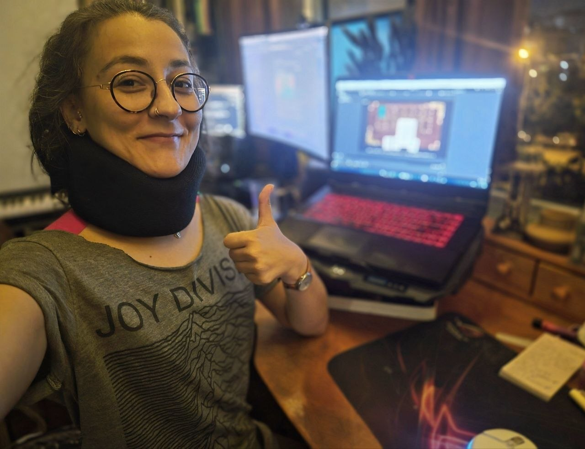

Hello Steam Community!

I’m Nian and this is my first solo-dev adventure ^^ After working with super talented teams for years, doing everything on my own this time has made me feel both free and talentless.

It started with a simple wish, while I was playing Librarian: Tidy up the Arcane Library and organizing all those books of magic, I thought “Aah this is amazing! I wish I could read these books!”. So I decided to make one, with real books, thanks to the amazing archives of [Project Gutenberg](https://www.gutenberg.org/) and [The Public Domain Review](https://publicdomainreview.org/).

I thought reading books would take up most of my time during the development process, but it turns out my reading speed was way faster than my drawing speed. As a result, I did a lot of drawing, and it took a toll on my spinal health, but zero regrets. I made a game by myself! I’m a solo-dev! How cool is that? Look how proud I am!

Even though I developed it solo, I was not alone: Emre Akdeniz wrote the music and designed the sound (I’m so lucky to have a musician/audio programmer boyfriend, because it’s apparently the only thing I can’t do on my own 😎), Deniz Polat gave the witch her voice, and Eser Kaya tested it more times than anyone should have to. Also, my mother was there for me when I said “I’m gonna do my own thing from now on.” Having her believe in me, even when she has no clue what I’m doing, is a kind of support I know not everyone has.

Anyway, virtual hugs and kisses if you made it this far in my totally unnecessary but heartfelt announcement. I was planning to show you some before/after screenshots, but I guess I felt like talking ^^ So see you next time!
